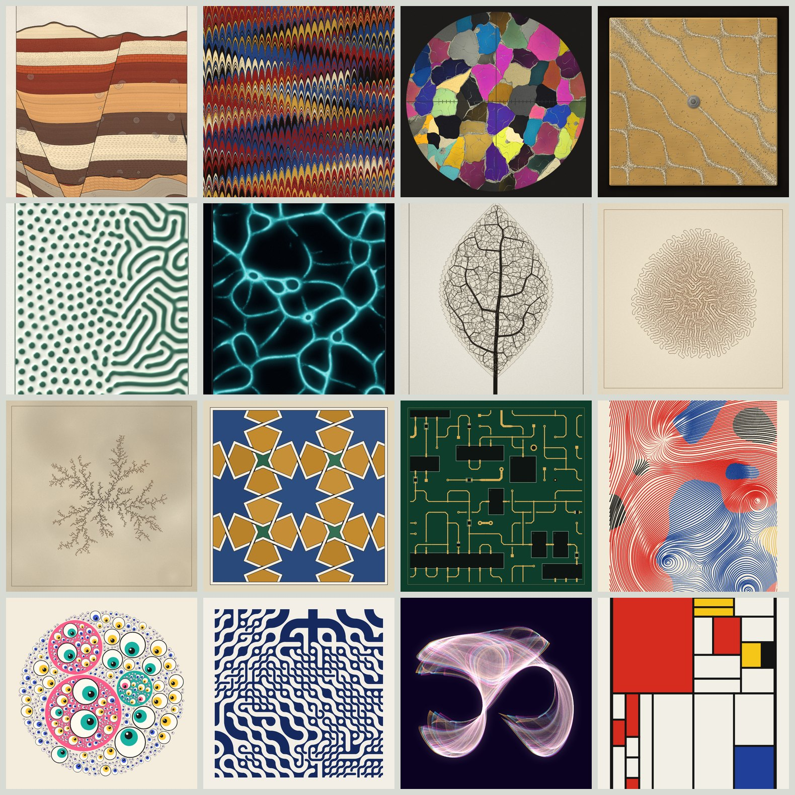

# Cabinet of Processes

Seventeen generative-art algorithms in p5.js, one per tab. Each has sliders whose values carry names from
the subject's own vocabulary, plus Randomize, Mutate, pins, a history strip, recipe codes and
print-size PNG export.

**Live:** https://adam-vozzo.github.io/cabinet-of-processes/



## The tabs

| Processes | What it does |
|---|---|
| Strata | Geological cross-sections: every pixel is traced back through folds, faults and dikes to a flat bed |
| Marbling | Paper marbling after Jaffer & Lu: ink drops, combs and swirls, inverted per pixel |
| Thin Section | A rock slice under a polarizing microscope, with real interference colours and a rotating stage |
| Chladni | Sand settling on the nodal lines of a vibrating plate |
| Reaction–Diffusion | Gray-Scott on the GPU, with the named regimes from Pearson and Munafo |
| Physarum | Jeff Jones's slime-mould agent model, up to three rival strains |
| Culture | The same agents inoculated on a slide and printed as stained cells: splatted by density, then each pixel climbs the slope of the brightness |
| Space Colonization | Runions' algorithm: leaves, trees, roots, sea fans, mycelium |
| Differential Growth | A curve that keeps growing in limited space and buckles into coral |
| DLA | Diffusion-limited aggregation: frost, mineral dendrites, electrodeposits |
| Star Patterns | Islamic geometric patterns by Hankin's polygons-in-contact method, with interlaced strapwork |
| Wave Collapse | Wave function collapse over hand-drawn vector tile sets |

| Classics | What it does |
|---|---|
| Flow Field | Evenly spaced streamlines (Jobard & Lefer) with relief shading |
| Circle Packing | Nested packings where every disc turns toward one focal point |
| Truchet | Smith, Carlson multi-scale, triangle, hexagon and weave tiles, traced into regions and strands |
| Attractors | Clifford, De Jong, Svensson, Bedhead, Gumowski–Mira and symmetric icons, with a quality gate |
| Subdivision | Recursive rectangle splits with rhyming fills and riso or collage print modes |

## Using it

- **New seed** keeps every slider and redraws. **Randomize** rolls every unpinned trait. **Mutate** nudges a few.
- The pin next to a slider keeps it fixed when you Randomize or Mutate.
- The **recipe** code holds the algorithm, seed and every slider. Paste one into the recipe box to load it.
- **Save PNG** renders about 3000 px tall.
- On Physarum and Culture, the line under the image counts the steps as the colony grows. Once it has finished, drag along the line to pick a stretch and save it as an MP4 (1080 px tall) or a GIF (480 px tall).
- Keys: `N` new seed, `R` randomize, `M` mutate, `S` save, `P` replay, `Esc` stop a growing run, `[` `]` step the seed, `,` `.` switch tabs.

Reaction–Diffusion, Strata, Marbling, Thin Section and Chladni need WebGL2.

## Running locally

There is no build step. Open `index.html` in a browser, or serve the folder:

```bash
python3 -m http.server 8000
```

## Structure

```
index.html          page, styles, script tags
core.js             module registry, seeded RNG, parameter helpers, recipe codes
media.js            MP4 (WebCodecs) and GIF encoders for saving a stretch of a process
ui.js               tabs, trait panel, p5 lifecycle, history, export
strata-engine.js    the Strata shader and its parameter space
modules/            one file per tab
docs/MODULES.md     how to write a new module
```

Each tab runs in its own p5.js instance (p5 1.11.13, loaded from cdnjs) while it is open.

## Credits

Built with [p5.js](https://p5js.org). 2D simplex noise in the shaders is by Ian McEwan, Ashima Arts (MIT).
The Voronoi edge distance follows Inigo Quilez. Culture's print follows a method vanity_ibex (Jakob Bock) described for his Houdini particle renders. Each tab's About text names the algorithm it implements. Inspired by long-form generative art such as Tyler Hobbs's Fidenza; none of its code or
palettes are used.
